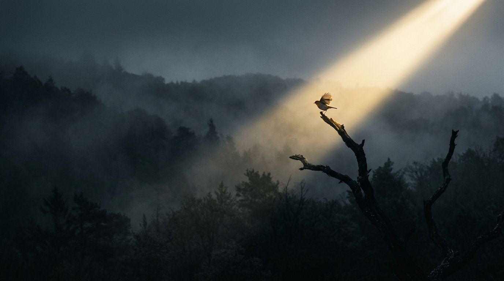

我以前特别瞧不上那种在公司群里屁大点事都要发战报、艾特所有人的人。

总觉得干活就干活，做成了大家自然看得见，天天把嗓门扯那么大，生怕别人不知道你在加班似的，带点市侩和浮躁。那时候我信奉的真理就两条：一条叫“事做漂亮了，公道自在人心”，另一条就是老祖宗传下来的“枪打出头鸟”。

现在回想起来，年轻时候那种自以为是的“清高”，其实蠢得厉害。

---

我吃过一次刻骨铭心的闷亏。

那是我工作第五年，带团队接手一个快要烂尾的客户项目。为了把数据救回来，我和两个同事在公司附近租了个快捷酒店，整整熬了三个礼拜。每天泡面配红牛，烟灰缸里塞满了烟头，硬生生把丢掉的关键指标拉回了正常水位。

项目上线那天，我累得站着都能睡着，但心里很踏实，觉得这么大的一场硬仗打赢了，领导心里肯定有数，不用我多嘴邀功。

结果到了月末的大例会上，大老板靠在转椅上，手里翻着各业务线的汇总表，在翻到我们这块时，眼皮都没抬一下，随口对旁边的副总说了句：

“这个业务线最近好像挺平稳的，没什么大动静，下个季度把预算和人力往别的部门压一压吧。”

我当时坐在长桌最靠门的那一头，整个人像是被兜头泼了一盆冰水，从后脖颈一路凉到脚底板。

我脑子里嗡嗡作响，手心全是冷汗，嘴巴张了半天，嗓子里却像塞了一团浸了水的棉花，硬是一个字都没憋出来。

散会后进了电梯，我搭档气得直接把手里的笔记本摔在扶手上，指着我鼻子骂：

“小林，你是不是脑子缺根弦？你熬得眼珠子通红、后背起了一层疹子，老板连你干了什么都不知道！你还指望他会读心术，半夜托梦去感受你的苦劳？”

那天站在空荡荡的电梯间里，看着镜子里自己那张蜡黄、写满委屈的脸，我突然想明白了一件事：

在今天这个环境里，**谁也没有义务透过你沉默寡言的躯壳，去挖掘你藏在深处的才华。**

---

很多人把“枪打出头鸟”当成护身符，一缩就是好几年。

说实话，我也理解那种心态。

低头做个“隐形人”太舒服了——不用在会上公开发言，不用承担被当众质疑的尴尬，不用面对别人的审视和挑刺。你躲在人群后面，把所有的退缩都美化成“稳重”、“踏实”、“不争名夺利”。

但这种自我感动，在现在的现实面前，脆弱得不堪一击。

现在的节奏多快啊。每个人手头都有一堆焦头烂额的破事，领导每天面对成百上千条信息，注意力早就被切得稀碎。他的眼睛不仅不雪亮，往往还高度近视。

你缩在角落里，不吭声、不露面、不出头，在别人眼里并不是你“靠谱低调”，而是你 **“不存在”**。

更残酷的是，当大环境变差、公司要裁员或者降本的时候，那些最先被随手划掉的名字，往往就是平日里最安静的人。

不是因为你犯了错，纯粹是因为对你没印象。

连砍掉你都不需要花任何心理成本，这哪是安全？这分明是任人宰割。

---

“枪打出头鸟”这句老话，本身并不假。

你冒尖了，别人会眼红；你站到亮处了，免不了有人在暗地里挑刺、放冷箭。

可问题在于——

**你得先是一只飞到半空中的鸟，猎人手里的枪才用得着瞄准你。**

现实里大多数老实人的悲哀，根本轮不到被枪打，而是在灌木丛的最深处，连翅膀都没张开过，就被落下来的枯枝烂叶给闷死了。

我不是劝大家去当那种没有真本事、到处抢风头的跳梁小丑。

真正的“先让人看见”，说白了就三句话：

做了漂亮事，大大方方讲出来，把前因后果和踩过的坑交代清楚，这是对你专业劳动的基本尊重；  
遇到硬骨头，在大家都退后半步的时候，敢往前迈一步接过来，这是你的担当；  
有自己的想法，别烂在肚子里，该表达的时候把声音放平稳、讲明白，这是你的辨识度。

这不叫钻营，这叫职业素养。

---

飞到亮处的那只鸟，确实有可能撞上风暴，甚至挨上一记冷枪。

但好歹，它见过高处的风，飞过辽阔的天空。

总好过一辈子缩在树杈底下，哪天树被人连根拔起的时候，连扑腾两下的力气都没有，直接被烂泥埋了个干净。
