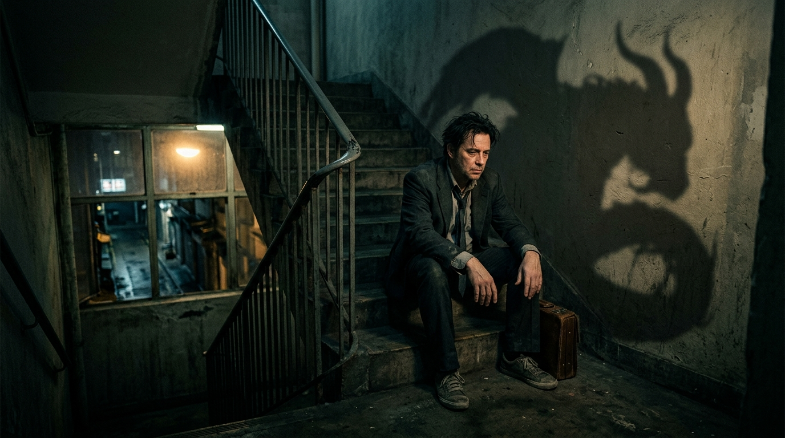

心理学家阿德勒曾说：“一切烦恼都来自人际关系，而人最难掌控的，往往是自己的心绪。”也有人说：“情绪是一个你控制了半辈子，还一直被它控制的怪物。如果你不跟它较劲，它就伤不到你；因为你太想消灭它，反而被它拖入了深渊。好好接纳你自己，不要妄图驯服本能。”

我们的失控来自于对情绪的过度压制。我们在追求所谓“情绪稳定”的假象中，往往忽视了内心最真实的感知，从而走向了自我内耗的死胡同。

“弹簧压得越紧，反弹就越凶猛。”当我们过度压抑内心的情绪时，潜意识的委屈和暴躁就会逐渐反扑，让我们陷入更大的崩溃之中。

生活中，成年人很多的心力交瘁，都是因为我们过于执着于“做个情绪稳定的大人”，而忽视了人本身是有喜怒哀乐的。我们总是活在“戒掉情绪是最高级自律”的规训中，却忘记了自己并不是冷冰冰的机器。

我们很多时候的抓狂，是因为苛求自己必须冷静，要求自己面对委屈和不公必须云淡风轻、滴水不漏，差一分都不行。

但生而为人，哪有那么多绝对的理智呢？

要想不被情绪吞噬，我们要适时转变思维。当我们不再视情绪为洪水猛兽，把胸怀放开，当我们允许自己有脆弱和愤怒的权利时，那种紧绷的失控感就会随之瓦解。

本是常人心，何苦强做神。

罗翔老师曾在访谈中谈到过自己的情绪体验：“我以前总觉得自己是个理性的人，受过最好的法学训练，凡事都能克制、冷静、条理清晰。但我后来发现，在很多具体的生活琐事和挫败面前，我内心的傲慢、暴躁和愤怒随时都会窜出来。你越觉得自己能掌控一切，现实越会狠狠给你一记耳光。”

这是大部分普通成年人的真实写照：以为自己修炼得百毒不侵，结果随时都在破防。

白天在公司被领导批评、被客户刁难，都能微笑着咬牙忍下，但那种隐忍的平静维持不了多久，深夜可能仅仅因为找不到一串钥匙，或者一盒外卖汤洒了，整个人就会彻底崩盘。

尼采在《善恶的彼岸》中有句名言：“与恶龙缠斗过久，自身亦成为恶龙；当你凝视深渊时，深渊也在凝视着你。”

人最容易被反噬的，就是试图消灭自己的本能。

人天生具有趋利避害和情绪波动的本能，我们却倾向于用最苛刻的标准来阉割自己的感受。

在崇尚“情绪价值”的现代社会，这种自我审查变得更加苛刻。我们在职场中小心翼翼地隐藏不悦，在社交圈里展示得体与包容，看到别人看似从容不迫的生活时，我们会不由自主地责备自己的敏感与暴躁。

压抑多了，情绪就从一泓流动的泉水变成了积怨的死水。

因此，压得越深，反噬越烈；控制得越狠，失控越频繁。

没有金刚不坏的铁石心肠，就不要硬装波澜不惊的圣人，打肿脸充胖子的克制，到头来反噬的只有自己的身体。

弗洛伊德曾说：“未被表达的情绪永远不会消失，它们只是被活埋了，并且将来会以更丑陋的方式爆发出来。”

我们总想去驯服这头名为情绪的猛兽，却极少真正倾听它背后的诉求。在压抑中从不思考这些愤怒和委屈到底从何而来。总想向外界证明自己的成熟与体面，如果这种体面全靠对自己抽刀断水，那么人生就变成了一场沉重的表演。

从小时候学会“懂事不哭”，到毕业后学会“微笑受委屈”，再到中年后学会“把牙咬碎咽进肚子里”，如此周而复始没有尽头、克制不止……

从来不问问自己是不是已经不堪重负，也不看看自己已经默默咽下了多少委屈，一味地强撑着体面，苛求自己无论发生什么都必须泰山崩于前而色不变。

内耗产生了，暴躁随之而来了，甚至于胸闷气短，彻夜难眠，一心想要修成没有任何杂念的情绪圣人，偏偏有些风浪尚能靠理智抵挡，有些源于生理极限与生存重压的情绪，恐怕终其一生也无法完全消除。

荣格说：“往外看的，在做梦；往内看的，才清醒。”

我们来人间一遭，不是为了把自己锻造成一台毫无知觉的螺丝钉，而是应该体验喜怒哀乐的完整人生。开心时畅快大笑，委屈时痛快倾诉，累了就允许自己发一发牢骚，感受真实的生命脉搏。

生而为人，有情绪是我们的特权。一个人要想活得松弛一点，就不能被所谓的“情商教条”捆绑手脚，学会辨析外界强加给我们的所谓标准，根据自己的内心承受力适时卸载负荷。

给自己的心房做减法，不要苛求自己时刻保持体面，尤其是那些你本就无法凭意念抵御的本能反应，徒给自己套上无形的枷锁。

王阳明曾说过：“心即理也，此心无私欲之蔽，即是天理，何必更有外求。”

喜怒哀乐，本是生命常态。

不跟自己的情绪死磕，允许一切感受自由流淌。当委屈和愤怒涌上心头时，不否定，不苛责，坦然接纳。

因为你不允许，该翻涌的情绪，照样会翻涌。你不允许情绪宣泄，未必能给现实助力，但一定会给自己的脏腑和神经带来沉重的内伤。

允许情绪的发生，是让内心真正变得宽广的过程。当你允许自己有脆弱的时候，你反而不再那么紧绷，整个人会渐渐变得舒展。境由心生，当你不再把情绪当敌人了，它的杀伤力也就变弱了。

苏轼在《定风波》中写道：“莫听穿林打叶声，何妨吟啸且徐行。竹杖芒鞋轻胜马，谁怕？一蓑烟雨任平生。”

坦然接纳，与己和解，才是成年人最通透的智慧。

每个人都有自己的承受极限，不必苛求自己永远如同铜墙铁壁。接纳自己的不完美，今天的你能对自己的情绪多一份宽容，这就是慈悲。

平常心对待，不要如临大敌。风来吹风，雨来淋雨，情绪如潮水，涨退皆有时，你只需静静看着它。

那些被你视作怪物的本能冲动，就当它是上天赋予你感知人间冷暖的“信使”来供奉。喜怒哀乐皆是馈赠，有时候，不抗拒才是最好的化解。

正所谓“世上本无枷，心锁困愚人”。情绪是一个你控制了半辈子、还一直被它控制的怪物；当你学会放下鞭子与它并肩而坐，它便不再是嗜人的野兽，而成了守护你血肉之躯的忠犬。
